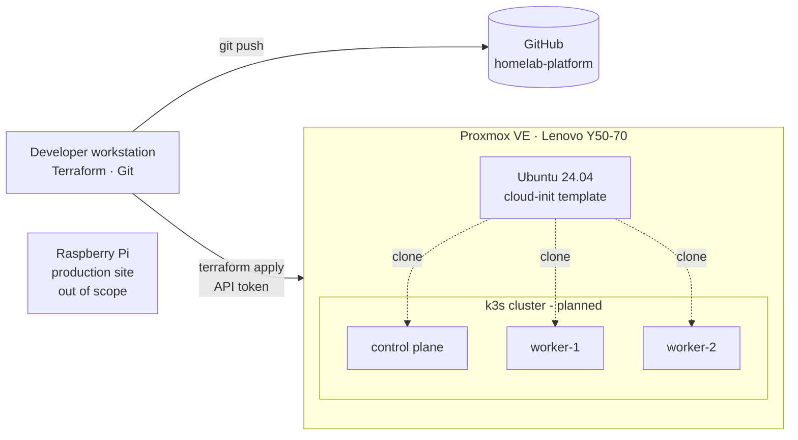

# homelab-platform

A self-hosted **Internal Developer Platform** built on repurposed hardware, designed to practice and demonstrate platform engineering: infrastructure as code, GitOps, policy as code, observability by default, and self-service for developers.

The goal is not just to run Kubernetes, but to build a platform where a developer can ship a new service through a paved road, and get monitoring, security guardrails and deployment automation without manual work.

> **Status:** Phase 1 (infrastructure as code) complete. See the [roadmap](#roadmap).

---

## Architecture



The production website runs on a separate Raspberry Pi and is intentionally kept out of this platform. Experimentation and production do not share infrastructure.

## Hardware

| Component | Spec |
|---|---|
| Host | Lenovo Y50-70 (2014 laptop) |
| CPU | Intel Core i7-4720HQ, 4 cores / 8 threads |
| Memory | 16 GB |
| Storage | 1 TB SATA SSD (ext4 + LVM-thin) |
| Hypervisor | Proxmox VE 9 |

Running a platform on a decade-old laptop is a deliberate constraint: it forces resource-conscious decisions about what each component actually needs.

## Tech stack

| Layer | Tool | Status |
|---|---|---|
| Virtualization | Proxmox VE | ✅ |
| Infrastructure as code | Terraform + `bpg/proxmox` provider | ✅ |
| VM provisioning | Ubuntu cloud images + cloud-init | ✅ |
| Kubernetes | k3s | 🔜 |
| GitOps | Argo CD | 🔜 |
| Observability | Prometheus, Grafana, Loki | 🔜 |
| Policy as code | Kyverno | 🔜 |
| Self-service | Platform CLI / Backstage | 🔜 |

## Repository structure

```
homelab-platform/
├── infra/
│   └── terraform/
│       └── proxmox/      # VM provisioning on Proxmox
├── .gitattributes
├── .gitignore
└── README.md
```

## Getting started

### Prerequisites

- Proxmox VE host with a cloud-init VM template (ID `9000`)
- Terraform >= 1.9
- An SSH key pair (`~/.ssh/id_ed25519.pub`)
- A Proxmox API token for a dedicated Terraform user (see [Security](#security))

### Provision

```bash
cd infra/terraform/proxmox

# Secrets live in a git-ignored file
echo 'proxmox_api_token = "terraform@pve!provider=<token>"' > terraform.tfvars

terraform init
terraform plan
terraform apply
```

Terraform clones the template, injects the SSH key through cloud-init, and outputs the VM's IP address via the QEMU guest agent. The whole environment can be torn down and recreated with `terraform destroy` / `terraform apply`.

## Security

Security is treated as a platform feature, not an afterthought.

- **Least privilege.** Terraform authenticates as a dedicated `terraform@pve` user with a custom role scoped to VM and datastore operations, never as `root`.
- **Token-based auth.** API tokens instead of passwords, so access can be revoked or rotated without touching user accounts.
- **Secrets stay out of Git.** `*.tfvars` and Terraform state are git-ignored. Exposed credentials are rotated, not reused.
- **Reproducible images.** The VM template has a cleared `machine-id` so every clone gets a unique identity.

## Design decisions

| Decision | Reasoning |
|---|---|
| Proxmox instead of bare-metal k3s | Terraform can provision real infrastructure, and the cluster can be destroyed and rebuilt in minutes |
| Cloud images instead of ISO installs | No manual installation steps; configuration happens at boot through cloud-init |
| ext4 + LVM-thin instead of ZFS | ZFS write amplification is a poor fit for a consumer QLC SSD |
| Separate production host | A broken experiment should never take down a live site |
| `.home.arpa` for internal names | Reserved for home networks (RFC 8375), so it never collides with a real domain |

Detailed Architecture Decision Records will live in `docs/adr/`.

## Roadmap

- [x] **Phase 0 – Foundations:** Proxmox host, networking, repository
- [x] **Phase 1 – Infrastructure as code:** Terraform user, cloud-init template, VM provisioning
- [ ] **Phase 2 – Kubernetes:** 3-node k3s cluster provisioned from code
- [ ] **Phase 3 – GitOps:** Argo CD app-of-apps managing all platform components
- [ ] **Phase 4 – Observability by default:** Prometheus, Grafana and Loki; every service gets metrics and logs automatically
- [ ] **Phase 5 – Policy as code:** Kyverno guardrails (resource limits, no `latest` tags, no root containers)
- [ ] **Phase 6 – Golden path:** service template with Dockerfile, manifests, CI pipeline and health checks
- [ ] **Phase 7 – Self-service:** one command to create a new service, repository and deployment

## Author

**Santeri Karppinen** – IT & cybersecurity, working toward platform and cloud engineering.
