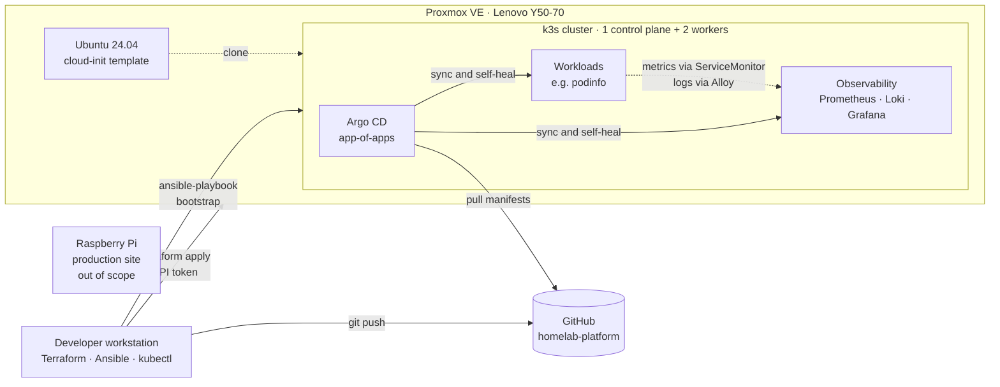

# homelab-platform

A self-hosted **Internal Developer Platform** built on repurposed hardware, designed to practice and demonstrate platform engineering: infrastructure as code, GitOps, policy as code, observability by default, and self-service for developers.

The goal is not just to run Kubernetes, but to build a platform where a developer can ship a new service through a paved road, and get monitoring, security guardrails and deployment automation without manual work.

> **Status:** Phase 4 (observability) complete: metrics, logs and dashboards for every workload, all deployed through GitOps. See the [roadmap](#roadmap).

---

## Architecture



The production website runs on a separate Raspberry Pi and is intentionally kept out of this platform. Experimentation and production do not share infrastructure.

## Hardware

| Component | Spec |
|---|---|
| Host | Lenovo Y50-70 (2014 laptop) |
| CPU | Intel Core i7-4720HQ, 4 cores / 8 threads |
| Memory | 16 GB |
| Storage | 1 TB SATA SSD (ext4 + LVM-thin) |
| Hypervisor | Proxmox VE 9 |

Running a platform on a decade-old laptop is a deliberate constraint: it forces resource-conscious decisions about what each component actually needs.

## Tech stack

| Layer | Tool | Status |
|---|---|---|
| Virtualization | Proxmox VE | ✅ |
| Infrastructure as code | Terraform + `bpg/proxmox` provider | ✅ |
| VM provisioning | Ubuntu cloud images + cloud-init | ✅ |
| Configuration management | Ansible + Ansible Vault | ✅ |
| Kubernetes | k3s (3 nodes) | ✅ |
| GitOps | Argo CD | ✅ |
| Observability | Prometheus, Grafana, Loki, Alloy | ✅ |
| Policy as code | Kyverno | 🔜 |
| Self-service | Platform CLI / Backstage | 🔜 |

## Repository structure

```
homelab-platform/
├── infra/
│   └── terraform/
│       └── proxmox/      # VM provisioning on Proxmox
├── ansible/
│   ├── inventory/        # hosts and group_vars (secrets in Ansible Vault)
│   └── playbooks/        # k3s installation, Argo CD bootstrap
├── platform/
│   ├── bootstrap/        # root Application (app-of-apps), applied once
│   ├── apps/             # one Argo CD Application per platform component
│   ├── argocd/           # Argo CD Helm values
│   ├── demo/             # podinfo demo app values
│   └── monitoring/       # kube-prometheus-stack, Loki and Alloy values
├── .gitattributes
├── .gitignore
└── README.md
```

## Getting started

### Prerequisites

- Proxmox VE host with a cloud-init VM template (ID `9000`)
- Terraform >= 1.9
- Ansible (with the `kubernetes` Python library), kubectl and Helm 3
- An SSH key pair (`~/.ssh/id_ed25519.pub`)
- A Proxmox API token for a dedicated Terraform user (see [Security](#security))
- An Ansible Vault password file at `~/.ansible-vault-pass`

### 1. Provision VMs

```bash
cd infra/terraform/proxmox

# Secrets live in a git-ignored file
echo 'proxmox_api_token = "terraform@pve!provider=<token>"' > terraform.tfvars

terraform init
terraform plan
terraform apply
```

Terraform clones the template, injects the SSH key through cloud-init, and outputs each VM's IP address via the QEMU guest agent.

### 2. Install k3s

```bash
cd ansible
ansible all -m ping
ansible-playbook playbooks/k3s.yml
```

The playbook installs a pinned k3s version on the control plane, joins the workers with the cluster token from Ansible Vault, and fetches a kubeconfig to `~/.kube/homelab.yaml`.

### 3. Verify

```bash
export KUBECONFIG=~/.kube/homelab.yaml
kubectl get nodes -o wide
```

### 4. Bootstrap secrets and Argo CD

```bash
cd ansible
ansible-playbook playbooks/bootstrap-secrets.yml
ansible-playbook playbooks/argocd.yml
```

`bootstrap-secrets.yml` generates in-cluster credentials (such as the Grafana admin password) once, so they never touch Git.

Installs a pinned Argo CD Helm chart with the values in `platform/argocd/` and applies the root Application. From then on Argo CD deploys everything under `platform/apps/` from Git, including its own upgrades.

The UI is published on the LAN only, through Traefik at `https://argocd.home.arpa`. Point the name at any node IP in your hosts file (for example `192.168.1.230 argocd.home.arpa`). As a fallback that bypasses the Ingress:

```bash
kubectl -n argocd port-forward svc/argocd-server 8080:80   # http://localhost:8080
```

Grafana is published the same way at `https://grafana.home.arpa`.

The whole environment can be torn down and rebuilt from scratch with `terraform destroy`, `terraform apply` and the playbooks.

## Security

Security is treated as a platform feature, not an afterthought.

- **Least privilege.** Terraform authenticates as a dedicated `terraform@pve` user with a custom role scoped to VM and datastore operations, never as `root`.
- **Token-based auth.** API tokens instead of passwords, so access can be revoked or rotated without touching user accounts.
- **Secrets stay out of Git.** `*.tfvars` and Terraform state are git-ignored. The k3s cluster token is encrypted with Ansible Vault, and tasks that handle it use `no_log`. Exposed credentials are rotated, not reused.
- **Key-only SSH.** VMs accept SSH keys injected by cloud-init; there are no passwords to leak or brute-force.
- **Reproducible images.** The VM template has a cleared `machine-id` so every clone gets a unique identity.

## Design decisions

| Decision | Reasoning |
|---|---|
| Proxmox instead of bare-metal k3s | Terraform can provision real infrastructure, and the cluster can be destroyed and rebuilt in minutes |
| Cloud images instead of ISO installs | No manual installation steps; configuration happens at boot through cloud-init |
| ext4 + LVM-thin instead of ZFS | ZFS write amplification is a poor fit for a consumer QLC SSD |
| k3s instead of kubeadm | CNCF-conformant Kubernetes with a fraction of the control-plane overhead; on 16 GB of RAM the savings go to observability and platform workloads instead |
| Terraform for VMs, Ansible for node configuration | Each tool does what it is best at: Terraform manages infrastructure lifecycle and state, Ansible handles idempotent OS and software configuration |
| Argo CD bootstrapped by Ansible | Argo CD cannot install itself, so Ansible does the first Helm install; after that Argo CD manages platform components from Git |
| App-of-apps | A single root Application watches `platform/apps/`; adding a component is a Git commit, not a manual `kubectl apply` |
| kube-prometheus-stack over lighter alternatives | The de facto standard for Kubernetes metrics, with ready-made dashboards and alerts; the cluster has room for it, unlike in later phases |
| Loki in single-binary mode on the filesystem | One pod, no object storage or memcached caches; the scalable modes cost more memory than the whole log volume justifies here |
| Few, stable log labels | Alloy attaches only namespace, pod, container, node and app; anything high-cardinality stays in the log line to keep Loki's index small |
| Cluster-wide ServiceMonitor discovery | Prometheus picks up monitors from any namespace, so a service opts into monitoring by shipping a ServiceMonitor, with no change to the monitoring stack |
| Generated secrets instead of committed ones | The repo is public; Ansible creates credentials once in the cluster until Sealed Secrets or SOPS is introduced |
| Lean Argo CD install | Dex and notifications disabled, single replicas and memory limits on every component; HA brings nothing on a single physical host |
| Pinned versions everywhere | Providers, k3s and (later) charts and images are pinned, so a rebuild produces the same platform as last time |
| Separate production host | A broken experiment should never take down a live site |
| `.home.arpa` for internal names | Reserved for home networks (RFC 8375), so it never collides with a real domain |

Detailed Architecture Decision Records will live in `docs/adr/`.

## Roadmap

- [x] **Phase 0 – Foundations:** Proxmox host, networking, repository
- [x] **Phase 1 – Infrastructure as code:** Terraform user, cloud-init template, VM provisioning
- [x] **Phase 2 – Kubernetes:** 3-node k3s cluster provisioned from code
- [x] **Phase 3 – GitOps:** Argo CD app-of-apps managing all platform components
- [x] **Phase 4 – Observability by default:** Prometheus, Grafana and Loki; every service gets metrics and logs automatically
- [ ] **Phase 5 – Policy as code:** Kyverno guardrails (resource limits, no `latest` tags, no root containers)
- [ ] **Phase 6 – Golden path:** service template with Dockerfile, manifests, CI pipeline and health checks
- [ ] **Phase 7 – Self-service:** one command to create a new service, repository and deployment

## Author

**Santeri Karppinen** – IT & cybersecurity, working toward platform and cloud engineering.
