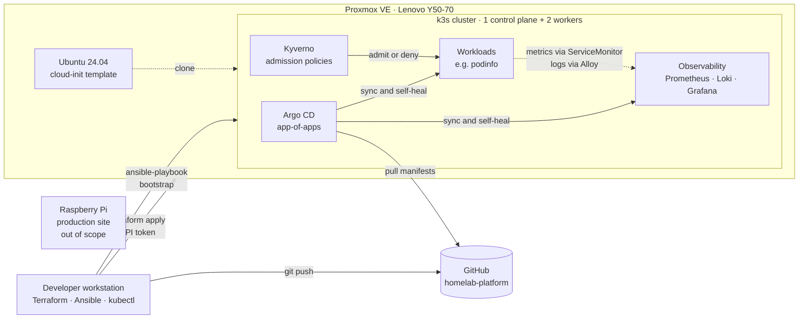

# homelab-platform

A self-hosted **Internal Developer Platform** built on repurposed hardware, designed to practice and demonstrate platform engineering: infrastructure as code, GitOps, policy as code, observability by default, and self-service for developers.

The goal is not just to run Kubernetes, but to build a platform where a developer can ship a new service through a paved road, and get monitoring, security guardrails and deployment automation without manual work.

> **Status:** Phase 6 (golden path) complete: a new service starts from [service-template](https://github.com/Karppimc/service-template) with code, Dockerfile and CI, gets a namespace with guardrails from one small file, and is deployed by Argo CD with the platform's service chart. [reference-service](https://github.com/Karppimc/reference-service) is the running example. See the [roadmap](#roadmap).

---

## Architecture



The production website runs on a separate Raspberry Pi and is intentionally kept out of this platform. Experimentation and production do not share infrastructure.

## Hardware

| Component | Spec |
|---|---|
| Host | Lenovo Y50-70 (2014 laptop) |
| CPU | Intel Core i7-4720HQ, 4 cores / 8 threads |
| Memory | 16 GB |
| Storage | 1 TB SATA SSD (ext4 + LVM-thin) |
| Hypervisor | Proxmox VE 9 |

Running a platform on a decade-old laptop is a deliberate constraint: it forces resource-conscious decisions about what each component actually needs.

## Tech stack

| Layer | Tool | Status |
|---|---|---|
| Virtualization | Proxmox VE | ✅ |
| Infrastructure as code | Terraform + `bpg/proxmox` provider | ✅ |
| VM provisioning | Ubuntu cloud images + cloud-init | ✅ |
| Configuration management | Ansible + Ansible Vault | ✅ |
| Kubernetes | k3s (3 nodes) | ✅ |
| GitOps | Argo CD | ✅ |
| Observability | Prometheus, Grafana, Loki, Alloy | ✅ |
| Policy as code | Kyverno (CEL ValidatingPolicy) | ✅ |
| Golden path | Service template (Go, distroless, GitHub Actions, Trivy, GHCR), namespace baseline, service chart | ✅ |
| Self-service | Platform CLI / Backstage | 🔜 |

## Repository structure

```
homelab-platform/
├── infra/
│   └── terraform/
│       ├── proxmox/      # VM provisioning on Proxmox (root configuration)
│       └── modules/      # reusable modules (k3s-node: one k3s VM)
├── ansible/
│   ├── inventory/        # hosts and group_vars (secrets in Ansible Vault)
│   └── playbooks/        # k3s installation, Argo CD bootstrap
├── platform/
│   ├── bootstrap/        # root Application (app-of-apps), applied once
│   ├── apps/             # one Argo CD Application per platform component
│   ├── argocd/           # Argo CD Helm values
│   ├── demo/             # podinfo demo app values
│   ├── kyverno/          # Kyverno Helm values
│   ├── policies/         # Kyverno ValidatingPolicies (CEL)
│   ├── alerts/           # PrometheusRules for Argo CD and Kyverno
│   ├── monitoring/       # kube-prometheus-stack, Loki and Alloy values
│   ├── namespace-baseline/  # Helm chart: namespace, quota, network policies, Argo CD project
│   ├── service-chart/    # Helm chart: Deployment, Service and ServiceMonitor for a service
│   └── workloads/        # one file per workload, deployed with the baseline chart
├── tests/
│   ├── policies/         # Kyverno CLI test cases: good, bad and edge-case pods per policy
│   └── alerts/           # promtool unit tests for the alert rules
├── scripts/              # CI checks that also run on the workstation: chart policies, namespace baseline, service chart
├── .github/workflows/    # validate: static checks on every pull request
├── .gitattributes
├── .gitignore
└── README.md
```

## Getting started

### Prerequisites

- Proxmox VE host with a cloud-init VM template (ID `9000`)
- Terraform 1.16 or newer (`~> 1.16`)
- Ansible (with the `kubernetes` Python library), kubectl and Helm 3
- An SSH key pair (`~/.ssh/id_ed25519.pub`)
- A Proxmox API token for a dedicated Terraform user (see [Security](#security))
- An Ansible Vault password file at `~/.ansible-vault-pass`

### 1. Provision VMs

```bash
cd infra/terraform/proxmox

# Secrets live in a git-ignored file: copy the example and fill in the token
cp terraform.tfvars.example terraform.tfvars

terraform init
terraform plan
terraform apply
```

Terraform clones the template, injects the SSH key through cloud-init, and outputs each VM's IP address via the QEMU guest agent.

### 2. Install k3s

```bash
cd ansible
ansible all -m ping
ansible-playbook playbooks/k3s.yml
```

The playbook installs a pinned k3s version on the control plane, joins the workers with the cluster token from Ansible Vault, and fetches a kubeconfig to `~/.kube/homelab.yaml`.

### 3. Verify

```bash
export KUBECONFIG=~/.kube/homelab.yaml
kubectl get nodes -o wide
```

### 4. Bootstrap secrets and Argo CD

```bash
cd ansible
ansible-playbook playbooks/bootstrap-secrets.yml
ansible-playbook playbooks/argocd.yml
```

`bootstrap-secrets.yml` generates in-cluster credentials (such as the Grafana admin password) once, so they never touch Git.

Installs a pinned Argo CD Helm chart with the values in `platform/argocd/` and applies the root Application. From then on Argo CD deploys everything under `platform/apps/` from Git, including its own upgrades.

The UI is published on the LAN only, through Traefik at `https://argocd.home.arpa`. Point the name at any node IP in your hosts file (for example `192.168.1.230 argocd.home.arpa`). As a fallback that bypasses the Ingress:

```bash
kubectl -n argocd port-forward svc/argocd-server 8080:80   # http://localhost:8080
```

Grafana is published the same way at `https://grafana.home.arpa`.

The whole environment can be torn down and rebuilt from scratch with `terraform destroy`, `terraform apply` and the playbooks.

## Onboarding a workload

A workload gets a landing zone: a namespace that arrives with its guardrails. Onboarding is two small files in a pull request.

**1. Describe the workload** in `platform/workloads/<name>.yaml`:

```yaml
name: shop                 # namespace and Argo CD project
owner: team-shop           # label on the namespace
quota: small               # small, medium or large
sourceRepos:               # where its Applications may deploy from
  - https://github.com/example/shop-deploy.git
```

An ApplicationSet turns the file into an Application that deploys the `platform/namespace-baseline` chart:

| Resource | What the workload gets |
|---|---|
| Namespace | Standard labels, owner and quota size as labels |
| ResourceQuota | CPU and memory requests, memory limits and pod count by size (`small`: 500m CPU, 512Mi requests, 1Gi limits, 10 pods; `medium` and `large` are two and four times that) |
| LimitRange | Default requests and memory limit for containers that set none |
| NetworkPolicies | Default deny in both directions; allowed: DNS, traffic inside the namespace, ingress from Traefik and from Prometheus |
| Argo CD AppProject | Deploys only from the listed repositories, only into this namespace, no cluster-scoped resources, and cannot change the quota or the limit range |

**2. Add an Argo CD Application** in `platform/apps/<name>.yaml` with `project: <name>` and the namespace as destination. `platform/apps/demo.yaml` with `platform/workloads/demo.yaml` shows it for a third-party Helm chart; `platform/apps/reference.yaml` with `platform/workloads/reference.yaml` shows it for a service built from the template.

### Deploying a service with the platform chart

A service does not write its own Deployment, Service and ServiceMonitor. The chart `platform/service-chart` renders them from a values file that lives in the service's repository:

```yaml
# deploy/values.yaml in the service's repository
name: shop
image:
  repository: ghcr.io/example/shop
  tag: 3f2c1e9a...          # the commit the image was built from; never latest
port: 8080
resources:
  requests: { cpu: 10m, memory: 32Mi }
  limits: { memory: 64Mi }
```

The chart adds what the policies ask for, so a service passes them by construction: the standard labels on the Deployment and its pods, `runAsNonRoot` with a numeric user, a read-only root filesystem, no privilege escalation and no capabilities, readiness and liveness probes on `/readyz` and `/healthz`, and a ServiceMonitor for `/metrics`. The schema rejects a missing image, the `latest` tag and missing memory settings before anything reaches the cluster.

The Application combines the chart from this repository with the values from the service's repository (both listed in `sourceRepos` of the workload file):

```yaml
spec:
  project: shop
  sources:
    - repoURL: https://github.com/karppimc/homelab-platform.git
      targetRevision: main
      path: platform/service-chart
      helm:
        releaseName: shop
        valueFiles:
          - $values/deploy/values.yaml
    - repoURL: https://github.com/example/shop.git
      targetRevision: main
      ref: values
  destination:
    server: https://kubernetes.default.svc
    namespace: shop
```

A new version is released by changing `image.tag` in the service's repository.

### Starting a new service

[service-template](https://github.com/Karppimc/service-template) is a GitHub template repository with everything a service needs before it has any business logic: a Go HTTP server with `/healthz`, `/readyz` and `/metrics`, a Dockerfile that builds a distroless non-root image with pinned base images, `deploy/values.yaml` for the chart above, and a CI pipeline that tests, builds, smoke-tests and scans the image, pushes it to GHCR tagged with the commit SHA, and runs this repository's `scripts/check-service-chart.sh` on the service's values, so a value the platform would refuse fails in the service's pull request.

[reference-service](https://github.com/Karppimc/reference-service) was created from it and runs in the namespace `reference`: the template's README lists the steps.

What the baseline does not do for you: traffic leaving the namespace (an external API, a database elsewhere) is denied until the workload adds its own NetworkPolicy, and removing the workload file leaves the namespace in place on purpose; deleting it is a deliberate, manual step.

## Alerting

Alertmanager sends platform alerts to one Discord channel. The webhook URL is a secret: it lives in Ansible Vault, `bootstrap-secrets.yml` writes it into the cluster, and Alertmanager reads it from a mounted file, so it is never in Git or in the Alertmanager configuration.

**What alerts exist**

| Source | Rules | Examples |
|---|---|---|
| kube-prometheus-stack defaults | 134 (32 critical, 93 warning, 7 info) | `KubePodCrashLooping`, `KubeNodeNotReady`, `KubeNodePressure` (memory, disk and PID pressure), `NodeFilesystemAlmostOutOfSpace`, `TargetDown`, `KubePersistentVolumeFillingUp` |
| `platform/alerts/argocd.yaml` | 3 | An application is Degraded for 10 minutes or OutOfSync for 15; the application metrics are missing |
| `platform/alerts/kyverno.yaml` | 2 | A denying policy rejected a request; the background scan found a resource that violates a denying policy |

Rules for the control-plane components that k3s runs inside one process (etcd, scheduler, controller manager, kube-proxy) are switched off: there is nothing to scrape, so they would only produce false alarms.

The platform's own rules are tested like the policies: `tests/alerts/` has `promtool` unit tests for each rule (it fires in the situation it is for and stays quiet otherwise), CI runs them, and a rule without a test fails the build. A wrong alert expression gives no error; the alert just never fires, so this is the only place such a mistake shows up.

**Where they go**

| Alerts | Receiver |
|---|---|
| `Watchdog` (always firing, proves the pipeline works), `InfoInhibitor`, everything with `severity: info` | Nowhere |
| Everything else, grouped by alert name and namespace, repeated every 12 hours while firing, with a message when resolved | Discord |

Before this, every alert went to a receiver called `null`: the rules fired and nobody heard them.

**Testing the pipeline**

A test alert is added with `amtool`, which ships in the Alertmanager image. It takes the same route as a real alert and resolves by itself after five minutes:

```bash
kubectl -n monitoring exec alertmanager-kube-prometheus-stack-alertmanager-0 -c alertmanager -- \
  amtool alert add PlatformTestAlert severity=warning namespace=monitoring \
  --annotation='summary="Test alert from the platform: the route to Discord works"' \
  --end="$(date -u -d '+5 minutes' +%Y-%m-%dT%H:%M:%SZ)" \
  --alertmanager.url=http://localhost:9093
```

The message appears in the Discord channel after the group wait of 30 seconds, and a "resolved" message follows when the alert ends. To see whether the notification left Alertmanager, look at its own counters: `alertmanager_notifications_total{integration="discord"}` goes up by one, and `alertmanager_notifications_failed_total{integration="discord"}` stays at zero.

Posting the alert as JSON through the API server proxy (`kubectl create --raw`) does not work: the request is rejected with `UnsupportedMediaType`.

## Security

Security is treated as a platform feature, not an afterthought.

- **Least privilege.** Terraform authenticates as a dedicated `terraform@pve` user with a custom role scoped to VM and datastore operations, never as `root`.
- **Token-based auth.** API tokens instead of passwords, so access can be revoked or rotated without touching user accounts.
- **Secrets stay out of Git.** `*.tfvars` and Terraform state are git-ignored. The k3s cluster token is encrypted with Ansible Vault, and tasks that handle it use `no_log`. Exposed credentials are rotated, not reused.
- **Key-only SSH.** VMs accept SSH keys injected by cloud-init; there are no passwords to leak or brute-force.
- **Reproducible images.** The VM template has a cleared `machine-id` so every clone gets a unique identity.

## Design decisions

| Decision | Reasoning |
|---|---|
| Proxmox instead of bare-metal k3s | Terraform can provision real infrastructure, and the cluster can be destroyed and rebuilt in minutes |
| Cloud images instead of ISO installs | No manual installation steps; configuration happens at boot through cloud-init |
| ext4 + LVM-thin instead of ZFS | ZFS write amplification is a poor fit for a consumer QLC SSD |
| k3s instead of kubeadm | CNCF-conformant Kubernetes with a fraction of the control-plane overhead; on 16 GB of RAM the savings go to observability and platform workloads instead |
| Terraform for VMs, Ansible for node configuration | Each tool does what it is best at: Terraform manages infrastructure lifecycle and state, Ansible handles idempotent OS and software configuration |
| Argo CD bootstrapped by Ansible | Argo CD cannot install itself, so Ansible does the first Helm install; after that Argo CD manages platform components from Git |
| App-of-apps | A single root Application watches `platform/apps/`; adding a component is a Git commit, not a manual `kubectl apply` |
| kube-prometheus-stack over lighter alternatives | The de facto standard for Kubernetes metrics, with ready-made dashboards and alerts; the cluster has room for it, unlike in later phases |
| Loki in single-binary mode on the filesystem | One pod, no object storage or memcached caches; the scalable modes cost more memory than the whole log volume justifies here |
| Few, stable log labels | Alloy attaches only namespace, pod, container, node and app; anything high-cardinality stays in the log line to keep Loki's index small |
| Alerts must reach a person | Alertmanager routes everything above info level to one Discord channel; an alert nobody receives is not monitoring. One channel on purpose: with one person on call, routing by team would only add places to forget to look. The webhook URL comes from Ansible Vault through a mounted Secret, not from Git |
| Audit before Enforce | Policies first ran in Audit/Warn mode; every finding was fixed or given an exception before switching to Deny, so enforcement broke nothing. Helm hook Jobs were checked separately because background scans never see them |
| Policies are tested like code | Every policy has good, bad and edge-case pods under `tests/policies/`, run with `kyverno test` in CI using the same Kyverno version as the cluster; a policy change that would let a bad pod through, or widen an exception, fails the pull request |
| Charts are checked against the policies before they are merged | CI renders every chart with the version and values from its Argo CD Application and applies the Kyverno policies to the workloads, Helm hook Jobs included. Policies that deny fail the pull request; policies still in Audit are printed as warnings. Background scans never see hook Jobs, and a rejected hook blocks the whole sync, so a chart upgrade that breaks a policy has to fail the pull request, not the cluster |
| One required CI check | The `validate` workflow runs Terraform, Ansible, YAML and Kubernetes checks as separate jobs, and a final `validate` job passes only if all of them did; branch protection requires that single name, so jobs can change without touching the ruleset. No job needs credentials or network access to the homelab |
| Protected `main`, no bypass | Argo CD deploys whatever lands on `main`, so a commit there is a deployment. A ruleset allows changes only through a pull request with a green `validate` check, squash-merged; nobody can push directly or force push, the owner included, so the cluster only ever runs validated commits |
| Standard labels as a policy, audited first | `require-standard-labels` requires `app.kubernetes.io/name`, `part-of` and `managed-by` on Deployments, StatefulSets, DaemonSets, Jobs, CronJobs (including their pod templates) and Pods. It ran in Audit first: most third-party charts label the controller but not the pods, so the findings were fixed through chart values, or given a narrow exception where the chart offers none, before it was switched to Deny. Jobs are matched themselves because a Job whose pods are rejected is created fine and then never completes, which would block an Argo CD sync without an error |
| A namespace baseline as the landing zone | A workload is one small file (name, owner, quota size, source repositories); an ApplicationSet deploys a local Helm chart with it: namespace, ResourceQuota, LimitRange, default-deny NetworkPolicies and an Argo CD AppProject limited to that namespace. A Helm chart rather than Kustomize, because name and quota size are parameters, not patches. Removing the file never deletes the namespace |
| A platform-owned service chart | Services supply a values file; the platform's chart renders the Deployment, Service and ServiceMonitor with the labels, security context, probes and metrics the policies ask for. A policy change is then fixed in one chart instead of in every service's copy of a template, and CI proves the chart passes every policy without an exception |
| Template and services in their own repositories | The template is a GitHub template repository and each service is its own repository with its own CI, as a team's service would be; this repository holds only what the platform owns (the baseline, the chart, the policies) plus two small files per workload |
| Image tag is the commit SHA; a release is a pull request | CI pushes one image per commit on `main` and never overwrites a tag. Deploying is a reviewed change of `image.tag` in the service's repository, which Argo CD picks up; rollback is a revert |
| No CPU limits in the baseline | The quota counts CPU requests but not CPU limits, and the LimitRange sets no default CPU limit: a CPU limit throttles a container that has idle cores next to it, while a memory limit protects the node |
| Narrow, centralised policy exceptions | Exceptions target one policy and one workload (Alloy must run as root to read node log files; the third-party podinfo chart cannot set the standard labels) and are honoured only in the `kyverno` namespace, so teams cannot exempt themselves |
| Fail-closed admission | `failurePolicy: Fail`: if Kyverno is down, matching resources are rejected rather than admitted unchecked; `kube-system` and `kyverno` are excluded so the cluster can always recover |
| CEL ValidatingPolicy over ClusterPolicy | Kyverno 1.19 deprecates ClusterPolicy; CEL is also what Kubernetes' built-in ValidatingAdmissionPolicy uses |
| Tainted control plane | k3s schedules workloads on its server by default; with 4 GB and a CRD-heavy API server that risks taking down cluster management, so only system components and node agents may run there |
| Cluster-wide ServiceMonitor discovery | Prometheus picks up monitors from any namespace, so a service opts into monitoring by shipping a ServiceMonitor, with no change to the monitoring stack |
| Generated secrets instead of committed ones | The repo is public; Ansible creates credentials once in the cluster until Sealed Secrets or SOPS is introduced |
| Lean Argo CD install | Dex and notifications disabled, single replicas and memory limits on every component; HA brings nothing on a single physical host |
| Pinned versions everywhere | Providers, k3s and (later) charts and images are pinned, so a rebuild produces the same platform as last time |
| Separate production host | A broken experiment should never take down a live site |
| `.home.arpa` for internal names | Reserved for home networks (RFC 8375), so it never collides with a real domain |

Detailed Architecture Decision Records will live in `docs/adr/`.

## Roadmap

- [x] **Phase 0 – Foundations:** Proxmox host, networking, repository
- [x] **Phase 1 – Infrastructure as code:** Terraform user, cloud-init template, VM provisioning
- [x] **Phase 2 – Kubernetes:** 3-node k3s cluster provisioned from code
- [x] **Phase 3 – GitOps:** Argo CD app-of-apps managing all platform components
- [x] **Phase 4 – Observability by default:** Prometheus, Grafana and Loki; every service gets metrics and logs automatically
- [x] **Phase 5 – Policy as code:** Kyverno guardrails (resource limits, no `latest` tags, no root containers, standard labels)
- [x] **Phase 6 – Golden path:** service template with Dockerfile, CI pipeline and health checks; namespace baseline; platform service chart; reference service running
- [ ] **Phase 7 – Self-service:** one command to create a new service, repository and deployment

## Author

**Santeri Karppinen** – IT & cybersecurity, working toward platform and cloud engineering.
